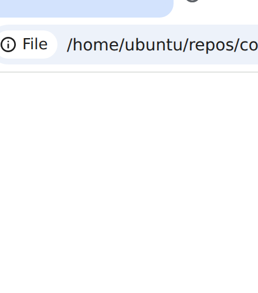

# Connections Planner

Plan every move for the NYT **Connections** puzzle before you submit a single guess. Instead of picking four words at a time, you can sort all 16 words into the four color groups and name each category.



## Running it

You don't need a server, a build step or an install. It works in any modern browser (Chrome, Edge, Firefox, Safari) on Windows, macOS and Linux.

1. Download the repo: **Code → Download ZIP** and unzip it, or `git clone https://github.com/suhaasr/connections-planner.git`.
2. Open `index.html` in your browser. Double-clicking it works, or you can drag it onto a browser window.

Your current puzzle, groups and category names are saved in the browser's local storage, so they come back when you reopen the file.

## How to use it

- **Enter words**: paste the 16 words, one per line or comma-separated, then click **Start planning**. **Load sample** fills in a demo puzzle. **Edit words** brings this screen back. If you change the words, your plan is reset.
- **Select words**: click any word to add it to a group. Groups fill four words at a time in priority order:
  - **easy-first** (default, yellow switch): Yellow → Green → Blue → Purple
  - **hard-first** (purple switch): Purple → Blue → Green → Yellow

  The active label is black and the inactive one is light grey.
- **Deselect**: click a highlighted word to remove it from its group. The next word you click goes into the highest-priority group that has fewer than four words, so a gap you open gets filled first.
- **Name categories**: when a group gets its first word, a box in that color appears below the grid so you can write down your guess for the category. The box stays even if you later deselect every word in that group. The boxes are listed in the current priority order.
- **Reorder**: drag a word onto another tile to move it there.
- **Shuffle**: shuffles only the words that aren't selected. Selected words stay where they are.
- **Deselect all**: clears every group but keeps your category names.

## Development

The app is plain HTML/CSS/JS with no dependencies:

- `index.html`: markup
- `style.css`: styles
- `logic.js`: state logic with no DOM code (selection priority, shuffle, reordering)
- `app.js`: rendering and event handling

It uses classic `<script>` tags rather than ES modules, because browsers block modules loaded from `file://` URLs.

Run the logic tests with Node 18+:

```sh
npm test
```
